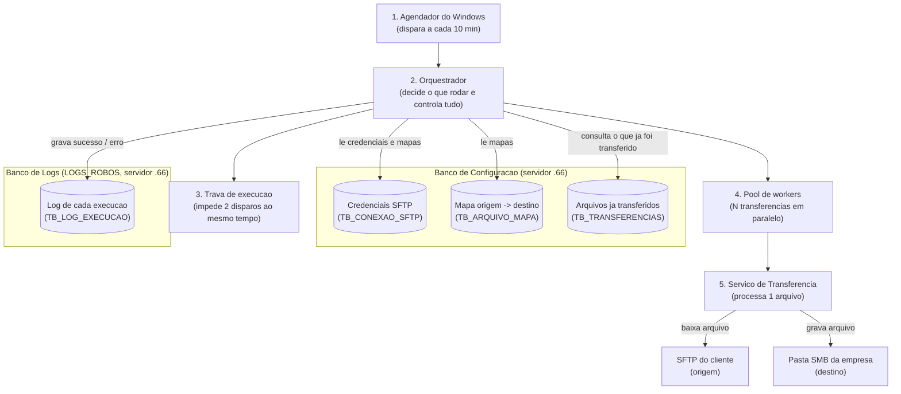
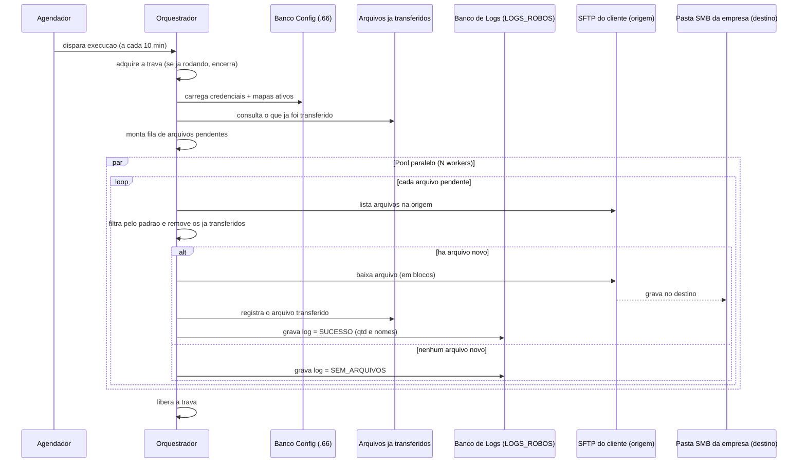

# 01 — Arquitetura e Diagrama

> **Fase 1 do fluxo.** Este documento é o desenho da solução antes do código.
> Decisões travadas com o responsável em 2026-08-14 (ver seção 5).

---

## 1. Visão em uma frase

Robô que, a cada 10 minutos, baixa arquivos do **SFTP de cada cliente** e os grava em um
**destino SMB local da empresa**, controlado por um **orquestrador** que lê a configuração no
banco, transfere apenas o que ainda não foi transferido e registra cada execução em log.

## 2. Diagrama de estrutura (componentes)

## 3. Diagrama de fluxo (processo principal — 1 disparo de 10 min)

> **Tratamento de erro:** qualquer falha em um mapa (conexão, download, gravação) é capturada,
> registrada em `TB_LOG_EXECUCAO` com `STATUS=ERRO` e a mensagem, **sem derrubar os demais mapas**.
> O arquivo que falhou **não** é registrado em `TB_TRANSFERENCIAS`, então será retentado no próximo disparo.

## 4. Fluxo de dados

- **Entrada (config):** `TB_CONEXAO_SFTP` (host, porta, usuário, senha/chave), tendo **`ID_CEDENTE`
  como chave principal**, e `TB_ARQUIVO_MAPA` (1 linha por arquivo), que casa com a credencial
  **por `ID_CEDENTE`**. O mapa guarda origem/destino/`PADRAO_ARQUIVO` e a flag `RENOMEAR_COM_DATA`.
  **Regra fixa (não é coluna):** todo `.zip` é descompactado e só o conteúdo (arquivo interno de
  mesmo nome, outra extensão) é gravado — o `.zip` não é salvo.
- **Processamento:** o orquestrador lista a origem, filtra pelo `PADRAO_ARQUIVO`, remove o que já
  está em `TB_TRANSFERENCIAS` e transfere o restante via stream (chunks) do SFTP direto para o SMB,
  aplicando as etapas ligadas pelas flags do mapa.
- **Saída (dados):** arquivos gravados no destino SMB.
- **Saída (controle):** 1 linha em `TB_TRANSFERENCIAS` por arquivo transferido (idempotência) e
  1 linha em `LOGS_ROBOS.TB_LOG_EXECUCAO` por processo executado (sucesso/erro/sem-arquivos),
  correlacionadas por `ID_EXECUCAO` (mesmo disparo).

### 4.1 Modelo de dados

> **DDL completo e autoritativo:** [`sql/01_criar_tabelas.sql`](../sql/01_criar_tabelas.sql).
> O resumo abaixo é conceitual; qualquer mudança de coluna vive no `.sql`.

**Banco `DB_SFTP` (configuração operacional, servidor .66):**

| Tabela | Papel | Chave / vínculo |
|---|---|---|
| `TB_CONEXAO_SFTP` | Credenciais do SFTP (1 por cedente): host, usuário, senha/`.pem`, porta, protocolo | **`ID_CEDENTE`** (PK / chave principal) |
| `TB_ARQUIVO_MAPA` | 1 linha por arquivo. Origem→destino + `PADRAO_ARQUIVO`, `SOMENTE_HOJE`, `RENOMEAR_COM_DATA` | `ID` (PK); `ID_CEDENTE` → `TB_CONEXAO_SFTP` |
| `TB_TRANSFERENCIAS` | Registro do que já foi transferido (idempotência) | `ID` (PK); `ID_MAPA` → `TB_ARQUIVO_MAPA`; único `(ID_MAPA, NM_ARQUIVO, DT_ARQUIVO)` |

**Banco `LOGS_ROBOS` (log de execução, servidor .66):**

| Tabela | Papel | Observação |
|---|---|---|
| `TB_LOG_EXECUCAO` | 1 linha por processo/mapa executado | `ID_EXECUCAO` agrupa o mesmo disparo; `STATUS` = SUCESSO / ERRO / SEM_ARQUIVOS |

> **Configuração no lugar de código:** o comportamento de cada arquivo é descrito pelas colunas do
> mapa. Um "processo novo" = inserir uma linha em `TB_ARQUIVO_MAPA` com as flags certas, **sem
> escrever código**. O serviço de transferência executa etapas genéricas ligadas por essas flags.

> **Idempotência x nomes repetidos:** clientes que reenviam com o **mesmo nome** todo dia
> (ex.: `remessa.csv`) são cobertos pelo `DT_ARQUIVO` na chave única; nomes que já vêm com data
> (ex.: `remessa_20260814.csv`) ficam únicos naturalmente.

## 5. Decisões de arquitetura

| Ponto | Escolha | Alternativas descartadas | Motivo |
|---|---|---|---|
| Orquestração | Um **orquestrador** único chamado pelo agendador | Vários `.bat` por processo (modelo atual do RoboCargas) | Evita sobrecarga e disparos redundantes; centraliza controle e log |
| Unidade de controle | **Por mapeamento de arquivo** (`TB_ARQUIVO_MAPA`) | Por conexão/cliente (modelo RoboCargas) | Granularidade fina: mesmo cliente pode ter vários arquivos/destinos, cada um controlado e logado à parte |
| Comportamento dos arquivos | **Orientado a dados** (colunas de flags no mapa) | Código por processo (`TIPO_PROCESSO` com `if/else`) | Adicionar processo = inserir linha, sem novo código; menos manutenção |
| Vínculo credencial↔arquivo | **Por `ID_CEDENTE`** | Por surrogate (`ID_CONEXAO`) | Mantém o padrão legado; `ID_CEDENTE` é a chave de negócio conhecida |
| "Concluído no dia" | **Idempotência por arquivo** (`TB_TRANSFERENCIAS`) | Marcar done após 1 sucesso; exigir lista de esperados | Nunca "trava" o dia; pega arquivos que chegarem mais tarde; mais seguro |
| Execução | **Pool paralelo limitado** (N workers) | Sequencial | Mais rápido com muitos clientes, mantendo o consumo sob controle |
| Banco de logs | Servidor `.66`, banco **`LOGS_ROBOS`** (conexão separada) | Mesmo banco da config | Log centralizado da empresa, isolado da configuração operacional |
| SFTP | `paramiko` | pysftp (sem manutenção) | Já usado e validado no RoboCargas; suporta senha e chave |
| Destino | SMB via `smbclient`/`smbprotocol` | `net use` + cópia de arquivo | Já usado no RoboCargas; escrita em stream por chunks |
| Banco | SQL Server via `pyodbc` | — | Padrão da equipe / infra existente (.66) |

## 6. Riscos e pontos de atenção

- **Sobreposição de disparos:** uma execução pode passar de 10 min. Mitigação: **lock** de execução +
  idempotência por arquivo (mesmo que rode 2x, não duplica).
- **Arquivo ainda em upload no SFTP:** ler antes de o cliente terminar de enviar gera arquivo truncado.
  Mitigação: validar estabilidade de tamanho antes de baixar (já existe `validar_arquivo_pronto` no RoboCargas).
- **Segurança das credenciais SFTP no banco:** senhas em texto na tabela. Decidir na Fase 3 se ficam
  em claro (como hoje), cifradas, ou se usa arquivo de chave `.pem`.
- **Instabilidade do SFTP/SMB:** retry com backoff (já existe padrão no RoboCargas); falha vira log ERRO
  e é retentada no próximo ciclo.
- **Concorrência no pool:** dois workers não podem pegar o mesmo mapa/arquivo. O orquestrador particiona
  a fila por mapa; escrita em log/registro é por linha (sem estado compartilhado).
- **Nomes de arquivo repetidos entre dias:** tratado pela chave `(ID_MAPA, NM_ARQUIVO, DT_ARQUIVO)`.

---

**Critério de pronto da Fase 1:** o diagrama cobre componentes, comunicação e fluxo de dados de ponta
a ponta e foi revisado com o responsável. _(Pendente de revisão final.)_
